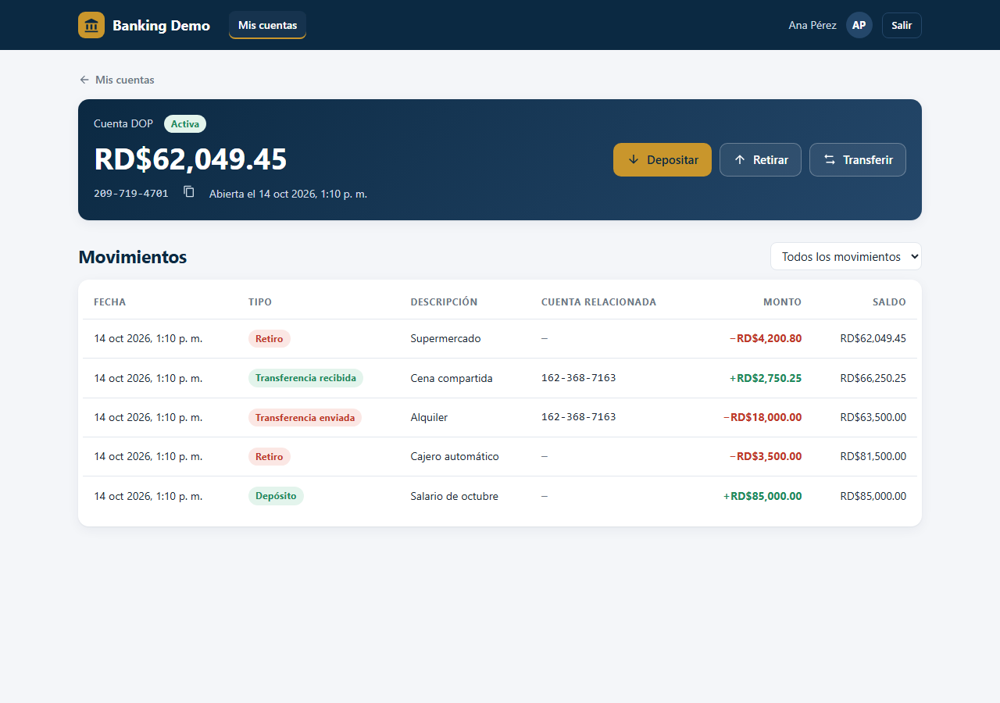
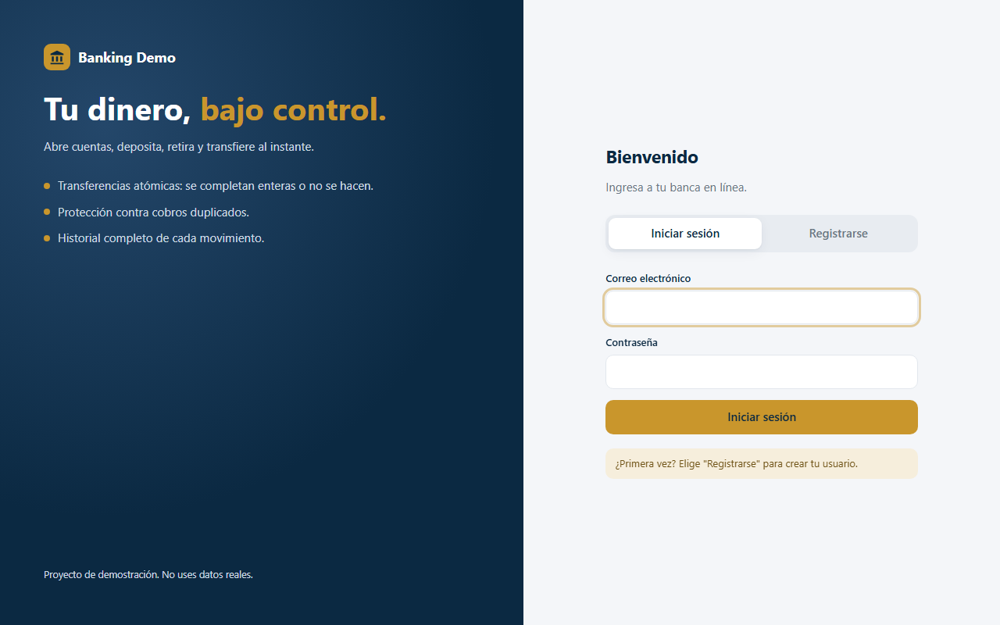
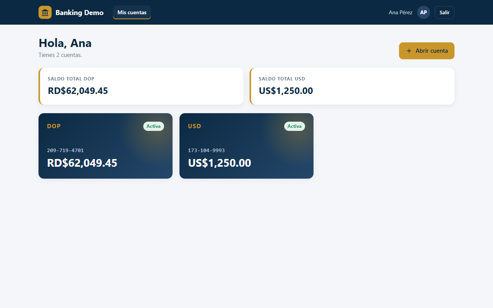
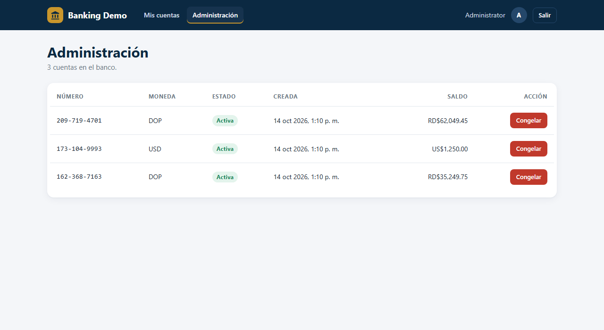

# Banking API


A REST API for a small bank, with a web client: customers register, open accounts, deposit, withdraw and transfer money.
It is built with **ASP.NET Core 9**, **Entity Framework Core** and **PostgreSQL**, and focuses on the things that matter when you move money: **atomic transactions, idempotent requests, safe concurrency and clear error handling**.



| Sign in | My accounts | Admin |
|---|---|---|
|  |  |  |

## Features

- **JWT authentication** with customer and admin roles, passwords hashed with BCrypt
- **Accounts** in DOP, USD or EUR, each with a unique 10-digit account number
- **Deposits, withdrawals and transfers** recorded in an immutable ledger
- **Database transactions**: a transfer updates both balances and writes both ledger entries, or nothing at all
- **Idempotency keys**: retrying a request (for example after a timeout) never charges twice
- **Optimistic concurrency**: two requests that read the same balance cannot both write it, so there are no lost updates or overdrafts
- **Paginated history** with filters by type and date range
- **Admin endpoints** to list all accounts and freeze or unfreeze them
- **Problem details** (RFC 7807) errors with machine-readable codes such as `insufficient_funds`
- **Web client** (Spanish UI) to sign in, manage accounts, move money and administer the bank
- **Swagger UI**, health check, Docker, and CI with GitHub Actions
- **26 automated tests** that run the real API against an in-memory database

## Tech stack

| Area | Technology |
|---|---|
| Framework | ASP.NET Core 9 (controllers) |
| Data | Entity Framework Core 9, PostgreSQL (Docker) or SQLite (local) |
| Auth | JWT bearer tokens, BCrypt |
| Web client | HTML, CSS and vanilla JavaScript (ES modules), no build step |
| Docs | Swagger / OpenAPI |
| Tests | xUnit, `WebApplicationFactory` integration tests |
| DevOps | Docker, Docker Compose, GitHub Actions |

## Getting started

### Option 1: Docker (API + PostgreSQL)

```bash
cp .env.example .env        # then edit the values
docker compose up --build
```

Open http://localhost:8080 for the web client, or http://localhost:8080/swagger for the API docs.

### Option 2: .NET SDK only (SQLite, no setup)

Requires the [.NET 9 SDK](https://dotnet.microsoft.com/download).

```bash
dotnet run --project src/BankingApi.Api
```

Open http://localhost:5042 for the web client, or http://localhost:5042/swagger for the API docs. In development an admin user is created automatically
(`admin@bank.local` / `Admin123!`, see `appsettings.Development.json`).

### Run the tests

```bash
dotnet test
```

## Try it

1. `POST /api/auth/register` with a name, email and password. Copy the `accessToken`.
2. Click **Authorize** in Swagger and paste the token.
3. `POST /api/accounts` with `{ "currency": "DOP" }`.
4. `POST /api/accounts/{id}/deposits` with `{ "amount": 1000 }` and an `Idempotency-Key` header (any unique string, such as a UUID).
5. Register a second user, open an account, and `POST /api/transfers` to it using its `accountNumber`.
6. Send the same transfer again with the **same** `Idempotency-Key`: you get the original result back (`200` plus `Idempotent-Replayed: true`) and no money moves.

Example with curl:

```bash
curl -X POST http://localhost:5042/api/transfers \
  -H "Authorization: Bearer $TOKEN" \
  -H "Idempotency-Key: 6f1c2a4e-0b7d-4d0e-9c1a-2f3b4c5d6e7f" \
  -H "Content-Type: application/json" \
  -d '{ "fromAccountId": "<your-account-id>", "toAccountNumber": "1234567890", "amount": 250.00, "description": "Rent" }'
```

## Endpoints

| Method | Route | Description |
|---|---|---|
| POST | `/api/auth/register` | Create a customer and get a token |
| POST | `/api/auth/login` | Get a token |
| GET | `/api/accounts` | List my accounts |
| POST | `/api/accounts` | Open an account |
| GET | `/api/accounts/{id}` | Account details and balance |
| GET | `/api/accounts/{id}/transactions` | History (`page`, `pageSize`, `type`, `from`, `to`) |
| POST | `/api/accounts/{id}/deposits` | Deposit (requires `Idempotency-Key`) |
| POST | `/api/accounts/{id}/withdrawals` | Withdraw (requires `Idempotency-Key`) |
| POST | `/api/transfers` | Transfer to any account number (requires `Idempotency-Key`) |
| GET | `/api/admin/accounts` | All accounts (admin) |
| POST | `/api/admin/accounts/{id}/freeze` | Block an account (admin) |
| POST | `/api/admin/accounts/{id}/unfreeze` | Unblock an account (admin) |
| GET | `/health` | Health check, including the database |

## Design decisions

**Ledger instead of just a balance.** Every movement is an immutable `Transaction` row with the balance after it. A transfer creates two rows (`TransferOut` and `TransferIn`) linked by a `TransferId`, so the history always explains the balance.

**Atomic operations.** Each operation runs inside a database transaction. If anything fails halfway, for example the destination account is frozen, nothing is saved.

**Idempotency.** Clients send an `Idempotency-Key` header. The key, a SHA-256 hash of the request and the resulting transaction are stored with a unique index on `(user, key)`:
- same key and same request → the original result is returned and no money moves;
- same key but a different request → `422 idempotency_key_reused`;
- two identical requests arriving at the same time → the unique index lets only one of them commit, and the other returns the first one's result.

**Concurrency.** `Account.Version` is an optimistic concurrency token that changes on every balance update. If another request changed the balance after it was read, EF Core raises a conflict and the operation is retried with fresh data, up to three times. This prevents lost updates and overdrafts without locking rows.

**Business rules live in the domain.** `Account.Debit` and `Account.Credit` enforce "no overdraft" and "no movements on frozen accounts", so the rules cannot be skipped by a new endpoint.

**Errors.** Rule violations return `422` problem details with a stable `code` that clients can rely on. Someone else's account returns `404`, not `403`, so account ids cannot be probed.

**Money.** Amounts are `decimal` with two decimal places, stored as `numeric(18,2)`. Never `double`.

**Web client.** The API serves the client from `wwwroot`, so both run from the same origin and no CORS setup is needed. The client creates one `Idempotency-Key` each time a money dialog opens, and resends that same key if the user retries after a network error. It keeps the token in `sessionStorage`, and it builds the page with `textContent` instead of `innerHTML`, so text such as transaction descriptions cannot inject HTML.

## Project structure

```
src/BankingApi.Api
├── Auth/            JWT options, token creation, claim helpers
├── Contracts/       Request and response DTOs
├── Controllers/     HTTP endpoints
├── Data/            DbContext and database initialization
├── Domain/          Entities, business rules and domain errors
├── Infrastructure/  Exception-to-problem-details handler
├── Services/        Auth, accounts and money movements
└── wwwroot/         Web client (index.html, css/, js/api.js, js/ui.js, js/app.js)
tests/BankingApi.Tests   Integration and concurrency tests
```

## Possible next steps

- EF Core migrations instead of `EnsureCreated`
- Refresh tokens and rate limiting on login
- Daily transfer limits per account
- Currency exchange between accounts
- Outbox pattern to publish events (for example, notifications) after each transfer

## License

MIT
